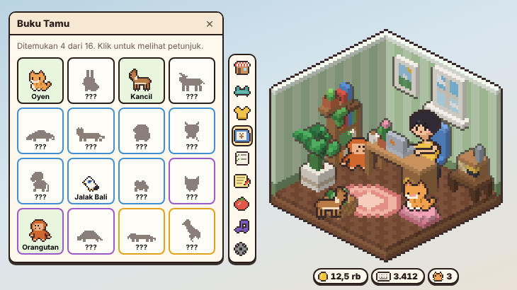
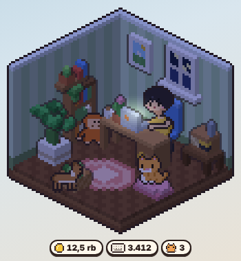

# Teman Kerja

Kamar kerja mungil di pojok layar desktop. Avatarmu duduk di depan laptop dan **ikut mengetik setiap kamu mengetik**, sementara **hewan-hewan mungil Nusantara** mampir bertamu kalau barang kesukaannya ada di kamar. Ada juga daftar tugas, memo, timer fokus (Pomodoro), dan radio. Dibuat dengan **Tauri 2 + TypeScript**, tanpa game engine. Semua gambar pixel art (kamar isometrik, barang, avatar, hewan) digambar oleh kode, dan semua musik dibuat langsung oleh aplikasi.





## Unduh dan main

Buka halaman **[Releases](https://github.com/iniArsat/teman-kerja/releases/latest)**. Installer dibuat otomatis oleh GitHub Actions setiap ada perubahan di branch `main`.

**Windows:** unduh file yang berakhiran `-setup.exe`, lalu klik dua kali untuk memasang.

**Mac (Apple Silicon dan Intel, macOS 10.15 atau lebih baru):**
1. Unduh file yang berakhiran `_universal.dmg`, buka, lalu seret **Teman Kerja** ke folder **Applications**.
2. Aplikasi ini belum ditandatangani Apple, jadi macOS menolaknya saat pertama dibuka. Buka **Terminal** dan jalankan sekali:
   ```
   xattr -cr "/Applications/Teman Kerja.app"
   ```
   Cara lain: coba buka sekali, lalu buka **System Settings → Privacy & Security** dan klik **Open Anyway**.
3. Agar avatar ikut mengetik, izinkan Teman Kerja di **System Settings → Privacy & Security → Input Monitoring**, lalu buka ulang aplikasinya.

Kamar muncul di pojok kanan bawah, di atas taskbar/Dock. Ikon Teman Kerja di tray (Windows: dekat jam; Mac: menu bar) untuk menampilkan, menyembunyikan, atau keluar.

## Cara main

- **Ikut mengetik.** Setelah kamu mengizinkan, setiap tombol keyboard yang kamu tekan di aplikasi mana pun membuat avatar mengetik di laptopnya. Setiap 25 ketukan menjadi 1 koin. HUD di bawah kamar menunjukkan koin, ketukan hari ini, dan jumlah tamu.
  - **Privasi:** yang dihitung hanya **jumlah** ketukan. Tombol apa yang ditekan tidak dicatat, tidak disimpan, dan tidak dikirim ke mana pun. Ketukan buatan program (makro) tidak dihitung, penghitung berhenti saat jendela tersembunyi, dan bisa dimatikan di Pengaturan.
- **Tamu.** 16 hewan Nusantara datang dan pergi sendiri. Masing-masing punya **barang kesukaan**: kancil datang kalau ada keranjang timun, musang luwak mencari mesin kopi di malam hari, jalak bali datang saat radio antik menyala, celepuk hinggap di atas jam dinding. Ada juga tamu langka:
  - **Komodo kecil** hanya menemui orang yang menyelesaikan 3 sesi fokus dalam sehari.
  - **Cendrawasih** hanya singgah di kamar yang sangat indah sambil diiringi gamelan.
  
  Arahkan kursor ke tamu untuk melihat namanya dan kapan ia pulang. Klik untuk **mengelus** dan menambah keakraban (5 hati). Tamu meninggalkan koin saat pulang, dan hadiah tambahan setiap hati baru.
- **Selama kamu pergi.** Tamu tetap datang saat aplikasi tertutup atau komputer tidur (paling lama 12 jam dihitung). Saat dibuka lagi, ada ringkasan siapa yang mampir dan berapa koin terkumpul.
- **Buku tamu.** Semua tamu yang pernah datang, dengan keterangan, barang kesukaan, jumlah kunjungan, dan keakraban. Tamu yang belum ditemukan tampil sebagai siluet dengan **petunjuk**.
- **Toko dan Atur Kamar.** 27 barang (lantai, dinding, meja, karpet) dan 12 tema dinding/lantai. Barang yang disukai tamu bertanda ikon kucing kecil. Ada 5 tempat lantai (dua di depan hanya untuk barang pendek), 4 di dinding, 2 di meja, dan 1 karpet. Keindahan kamar naik setiap barang dipasang.
- **Gaya avatar.** Warna kulit, 9 gaya rambut (termasuk hijab), warna rambut, 6 atasan (termasuk batik), warna atasan, dan 5 aksesori (kacamata, bando bunga, peci, topi, headphone).
- **Daftar tugas** (+5 koin per tugas selesai, maksimal 10 per hari), **memo** yang tersimpan otomatis, dan **timer fokus** 15/25/45/50 menit dengan istirahat 5/10/15 menit. Sesi fokus yang selesai memberi koin dan pemberitahuan sistem.
- **Radio.** Tiga stasiun yang dibuat langsung oleh aplikasi, jadi tidak pernah sama persis dan bebas hak cipta: **Lo-fi Santai**, **Gamelan Senja**, dan **Suara Hujan**.
- **Siang dan malam.** Langit di jendela dan cahaya kamar mengikuti jam komputermu. Di malam hari kamar meredup dan lampu-lampu menyala.
- Avatar sesekali minum, meregangkan badan, menyemangati, dan tertidur kalau kamu lama tidak mengetik.
- **Pengaturan:** posisi kiri/kanan bawah, ukuran kamar (kecil, sedang, besar), efek suara, pemberitahuan fokus, kata penyemangat, jalankan saat komputer menyala, dan statistik.

## Batasan yang diketahui

- Penghitung ketikan sistem ada di Windows dan macOS. Di Mac, izin Input Monitoring perlu diberikan ulang setelah memasang versi baru, karena aplikasinya belum ditandatangani Apple.
- Penyembunyian otomatis saat ada aplikasi layar penuh baru tersedia di Windows.
- Versi Mac dibuat dan diperiksa otomatis oleh GitHub Actions, tetapi belum dicoba langsung di Mac sungguhan.

## Pengembangan

```
npm install
npm run dev          # mode browser di http://localhost:1420
npm test             # tes inti permainan dan gambar
npm run tauri dev    # aplikasi desktop (butuh Rust)
```

Di mode browser, `tk.game` tersedia di konsol untuk mencoba-coba, misalnya `tk.game.state.coins = 50000`.

Struktur:
- `src/core`: aturan permainan murni (state, tamu, toko, fokus, simpanan), bisa diuji tanpa browser.
- `src/render`: penggambar voxel isometrik, model barang, sprite avatar dan hewan, penyusun bingkai dengan uji kedalaman per piksel.
- `src/ui`: panel, HUD, suara, dan radio WebAudio.
- `src-tauri`: jendela transparan di pojok, klik tembus, tray, file simpanan, pemberitahuan, dan penghitung ketukan.

Terinspirasi oleh genre desktop companion seperti *Working with Montabi*, tetapi semua nama, karakter, gambar, dan musik di sini orisinal.
